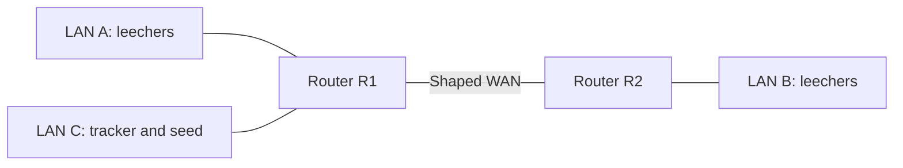
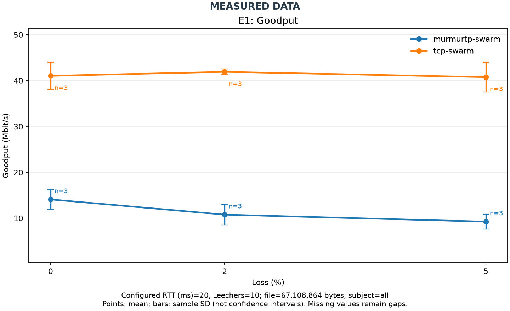
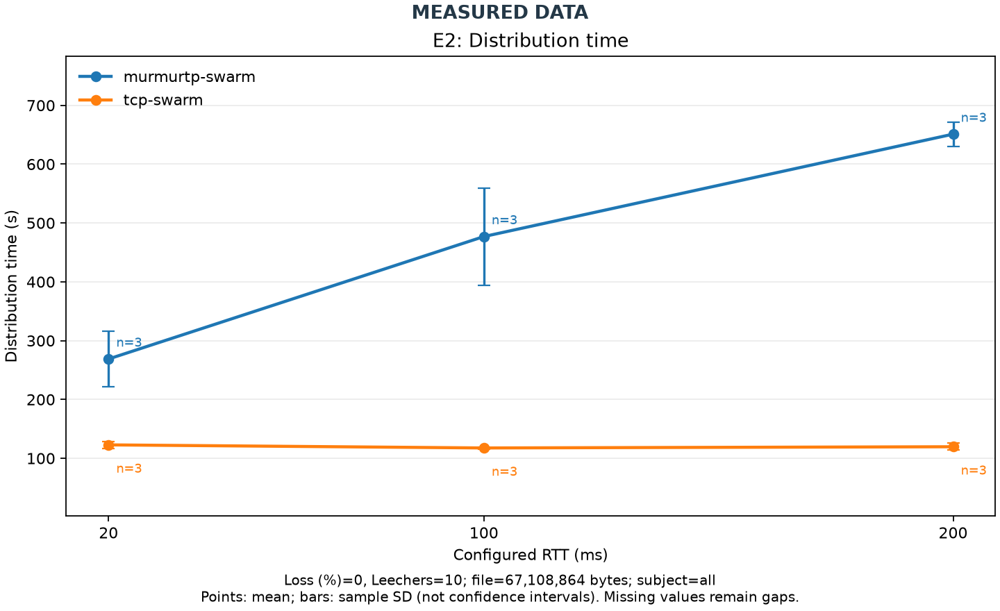
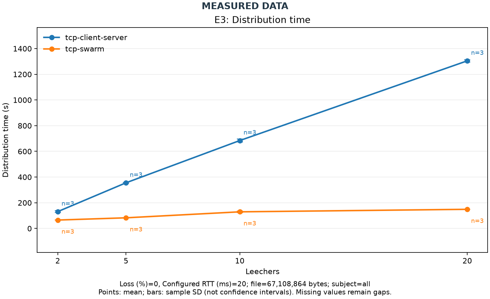
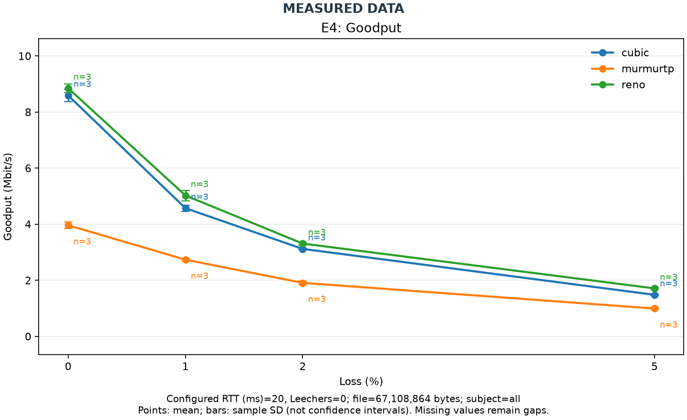
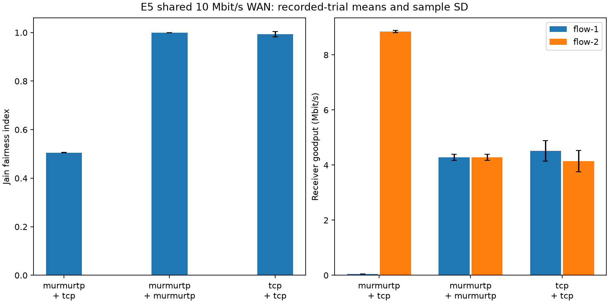

# Murmur: reliable UDP transport and peer-assisted file distribution

**Report draft for review — 23 November 2026.** This report describes the
implemented system and published E1–E5 measurements. It does not certify final
release acceptance. Fresh-VM verification, the complete combined experiment
command, independent protocol review and final demonstration remain open.

## 1. Problem and objectives

A server distributing the same file to many receivers must repeatedly supply
the payload through its uplink. Murmur investigates whether receivers can
reduce that burden by sharing verified pieces with one another. It also
implements MurmurTP, a reliable byte-stream transport over UDP, to study
retransmission, flow control and congestion control alongside native TCP.

The objectives are to deliver correct files, expose transport and swarm
behaviour through logs and packet traces, compare distribution strategies,
and make the measurements reproducible. Outperforming production TCP is not
an acceptance requirement. The results show substantial scaling benefits for
the TCP swarm, but lower MurmurTP throughput and a serious mixed-flow fairness
limitation in the tested configuration.

## 2. Architecture and addressing

The Python implementation combines an HTTP tracker, peer discovery, framed
swarm messages, piece storage and a selectable TCP or MurmurTP transport.
Experiment runners create Linux network namespaces and routed virtual links,
apply impairments, supervise packet capture, verify payloads and export results.
The browser dashboard reads peer event logs and supports live demonstrations
and replay of recorded runs. Replay visualizes existing evidence; it does not
perform another transfer.

| Segment | Addressing and roles |
|---|---|
| LAN A | `10.0.1.0/24`; R1 `.1`; leechers start at `.11` |
| LAN B | `10.0.2.0/24`; R2 `.1`; leechers start at `.11` |
| LAN C | `10.0.3.0/24`; R1 `.1`; tracker `.10`; seed `.11`; dashboard address reserved at `.12` |
| WAN | `10.0.12.0/30`; R1 `wan0` `.1`; R2 `wan0` `.2` |

The standard swarm uses five leechers on each LAN. LAN A and the seed share
R1; LAN B is across the shaped WAN. Local peer traffic therefore does not all
cross the bottleneck. Virtual-interface offloads are disabled for the lab.
The [reproduction guide](reproduce.md) provides setup and verification commands.

## 3. Swarm design

The normal 64 MiB workload contains 256 pieces of 256 KiB, requested in blocks.
Peers advertise availability using BITFIELD and HAVE messages. Storage only
marks pieces owned after hash verification, and the runner independently checks
each completed file against the seed's SHA-256 digest.

The [wire codec](wire-codec.md) uses a four-byte big-endian length followed by
a message type and payload. Messages cover the handshake, availability,
interest, choking, block requests and piece data. This framing is shared by
both transports, keeping application-level comparisons consistent.

[Piece selection](piece-selection.md) first considers eligible pieces that
have already been started, then selects the least available piece in that
group. Seeded random tie-breaking avoids a fixed global choice order.
The scheduler excludes work with no currently requestable blocks.

The [choking policy](choking.md) has four regular upload slots and one
optimistic slot. Regular selection is reviewed every ten seconds and the
optimistic selection every thirty seconds. Leechers rank peers by received
rate; seeds rank by uploaded rate. Disconnects and interest changes update
eligibility without waiting for the next periodic review.

For E3's client-server baseline, leechers download directly from the origin
and do not upload payload. An incomplete client can reconnect to the origin
within its transfer deadline while retaining verified pieces. This matters
because an earlier ten-client trial stalled when one origin session exceeded
its abandoned-request limit; the published final E3 dataset follows the fix.

## 4. MurmurTP design

MurmurTP provides connection establishment, ordered delivery, selective
retransmission, adaptive retransmission timeouts, congestion control and
receiver-window flow control over UDP. The implementation was developed in
stages; [the integration guide](murmurtp-integration.md) connects these stages
to the peer application.

| Header field | Bytes |
|---|---:|
| Flags | 1 |
| Connection identifier | 2 |
| Sequence number | 4 |
| Cumulative acknowledgement | 4 |
| Advertised receive window | 2 |
| SACK bitmap | 4 |
| Timestamp | 4 |
| Payload length | 2 |
| Checksum | 2 |

The header occupies 25 bytes, with up to 1,200 payload bytes per packet.
Multibyte header fields use network byte order. A SYN/SYN-ACK/ACK exchange
establishes the connection. Cumulative acknowledgements identify the next
expected sequence, while bitmap bit `i` acknowledges sequence
`cumulative_ack + 1 + i`. This allows the sender to distinguish a missing
packet from later packets already received. FIN and acknowledgements close
each direction; the captured close exchange is discussed below.

The adaptive timer starts at one second and is bounded between 0.2 and five
seconds. With a new valid RTT sample `R`, the estimator updates variation as
`0.75 × RTTVAR + 0.25 × |SRTT − R|` and the smoothed estimate as
`0.875 × SRTT + 0.125 × R`. The timeout uses
`SRTT + max(0.01 seconds, 4 × RTTVAR)`, subject to the bounds. Retransmitted
packets do not provide ambiguous RTT samples, and timeout backoff doubles
the timer up to its maximum.

Congestion control starts with ten packets. Slow start grows the window by
one packet per newly acknowledged packet; congestion avoidance grows by
approximately `1/cwnd`. SACK-based loss recovery reduces the window, while a
timeout resets it to one packet. Receiver capacity separately constrains
outstanding data. Window updates and zero-window probes allow progress when
the receiving application resumes reading.

These mechanisms provide an experimental transport, not a claim of TCP
equivalence or Internet deployment readiness. Independent review of the
[protocol specification](murmurtp-spec.md) remains open.

## 5. Methodology and evidence

Measurements ran in an Ubuntu VirtualBox environment using namespaces within
one VM. The default WAN and seed uplink caps were 10 Mbit/s. WAN delay and
loss were applied separately in each direction; a configured 20 ms RTT means
10 ms delay per direction, before additional queueing and scheduling delays.
Token-bucket shaping can introduce queue drops even with zero configured
random loss.

Each condition has one excluded warm-up and three recorded trials. Across
E1–E5 there are 35 conditions, or 140 planned successful trials including
warm-ups. Checkpoints preserve verified trials on resume; interrupted attempts
are retained as provenance rather than counted as extra observations. The
experiments were completed individually. A full run through the combined
`make experiments` command has not yet been verified.

| Experiment | Conditions | Recorded trials | Source revision |
|---|---:|---:|---|
| E1/E2: loss and RTT sweeps | 12 | 36 | `ebe8b38` |
| E3: scaling, two distribution modes | 8 | 24 | `2b141d2` |
| E4: three single-flow transports | 12 | 36 | `a95279a` |
| E5: three competing-flow pairings | 3 | 9 | `9bf806c` |

The [results index](../results/README.md) links per-trial metrics, summaries,
plots and manifests. Means and sample standard deviations describe three
observations, not a broad population or a statistical significance test.

Distribution time ends at the last verified download. Swarm goodput divides
all leechers' verified payload bits by that time, so it can exceed the WAN
capacity through parallel local transfers. E3 WAN traffic is the R1 `wan0`
RX-plus-TX byte delta; it includes network overhead. Seed upload share is the
seed's fraction of total uploaded payload. E4 measures a single receiver's
goodput. These quantities are not interchangeable.

## 6. Results and interpretation

### E1: loss sensitivity

| Loss per direction | TCP swarm goodput (Mbit/s) | MurmurTP swarm goodput (Mbit/s) |
|---:|---:|---:|
| 0% | 41.05 | 14.08 |
| 2% | 41.92 | 10.77 |
| 5% | 40.77 | 9.25 |

Loss was expected to add recovery work. MurmurTP's mean goodput decreased
and its mean retransmission count rose from 6,596 to 11,924. TCP's aggregate
swarm rate stayed near 41 Mbit/s. This does not imply TCP is immune to loss:
the metric includes local delivery, and piece scheduling affects the last
completion. All published trials verified the files. MurmurTP was slower in
this sample; delivery correctness and transfer speed are separate outcomes.
See [E1/E2 data and definitions](../results/e1-e2/README.md).

### E2: RTT sensitivity

The table averages the five peers' mean goodputs on each LAN, in Mbit/s.

| Configured RTT | TCP LAN A | TCP LAN B | MurmurTP LAN A | MurmurTP LAN B |
|---:|---:|---:|---:|---:|
| 20 ms | 7.21 | 4.39 | 2.55 | 2.34 |
| 100 ms | 7.33 | 4.59 | 2.24 | 1.53 |
| 200 ms | 7.46 | 4.51 | 1.49 | 0.83 |

Longer feedback delays were expected to affect transfers crossing the WAN.
LAN B's MurmurTP peer rate fell from 2.34 to 0.83 Mbit/s, while TCP stayed
close to 4.5 Mbit/s. LAN A's proximity to the seed and local peer exchanges
help explain why the two LANs need separate presentation. E1 and E2's
independent zero-loss, 20 ms baselines also show MurmurTP variability.
The experiment does not isolate a particular timer or congestion algorithm
as the cause of the difference.

### E3: swarm scaling versus client-server

| Leechers | Client-server time (s) | Swarm time (s) | Seed payload share in swarm | WAN savings |
|---:|---:|---:|---:|---:|
| 2 | 130.97 | 65.40 | 50.99% | −9.61% |
| 5 | 355.31 | 82.83 | 23.14% | 14.41% |
| 10 | 684.15 | 129.38 | 13.19% | 54.33% |
| 20 | 1,304.68 | 149.01 | 6.70% | 64.32% |

Peer assistance was expected to reduce repeated seed uploads. At twenty
leechers, the swarm completed in about 2 minutes 29 seconds versus
21 minutes 45 seconds for client-server. Leechers supplied 93.30% of uploaded
swarm payload. WAN savings were positive from five peers upward, but the
two-peer swarm used 9.61% more WAN bytes. Peer assistance therefore did not
universally reduce WAN traffic, even though it improved completion time at
every tested count. See [E3 evidence](../results/e3/README.md).

### E4: single-flow transport behaviour

| Loss per direction | TCP Reno (Mbit/s) | TCP CUBIC (Mbit/s) | MurmurTP (Mbit/s) |
|---:|---:|---:|---:|
| 0% | 8.85 | 8.59 | 3.96 |
| 1% | 5.02 | 4.57 | 2.73 |
| 2% | 3.31 | 3.12 | 1.91 |
| 5% | 1.71 | 1.48 | 0.99 |

Unlike E1's aggregate swarm measure, this experiment places a single flow
across the WAN. All three transports slowed as loss rose. Reno had the
highest mean at each level. MurmurTP still verified all recorded files at
5% loss, with individual rates between 0.959 and 1.027 Mbit/s.

The RTT comparison is the mean absolute difference between sender smoothed
RTT and concurrent ping RTT. At zero loss, means were 56.72 ms for Reno,
61.62 ms for CUBIC and 10.90 ms for MurmurTP; at 5% they were 14.03, 16.80
and 24.19 ms. Different queueing and sampling of ICMP and transport packets
prevent interpreting this as ground-truth estimator error.

[Window and RTT traces](../results/e4/E4-traces-loss5.png) illustrate recovery
behaviour; the published trace figures use the first recorded trial at each
loss level. A large window alone did not ensure high goodput: MurmurTP's
zero-loss sampled peak was larger than either TCP variant's, despite its
lower delivery rate. [E4 data](../results/e4/README.md) retain all recorded
time series for further analysis.

### E5: competing-flow fairness

Both flows start after a shared readiness gate. Rates use the middle 60% of
their common receiver payload interval, excluding solo transfer periods.
Cumulative byte counters are interpolated at the measurement boundaries.
For rates `x` and `y`, Jain fairness is `(x+y)² / (2(x²+y²))`.

| Pairing | Flow 1 Mbit/s, mean ± SD | Flow 2 Mbit/s, mean ± SD | Jain index, mean ± SD |
|---|---:|---:|---:|
| MurmurTP / CUBIC | 0.049 ± 0.003 | 8.850 ± 0.044 | 0.505502 ± 0.000340 |
| MurmurTP / MurmurTP | 4.283 ± 0.112 | 4.284 ± 0.115 | 0.99999984 ± 0.00000026 |
| CUBIC / CUBIC | 4.519 ± 0.369 | 4.140 ± 0.389 | 0.993075 ± 0.011468 |

Equal sharing would give an index of one. Same-transport pairs shared the
link closely, but the mixed pair was severely imbalanced: CUBIC accounted
for 99.45% of combined mean goodput in the common window. MurmurTP eventually
completed every mixed trial, yet eventual completion does not demonstrate
fair coexistence. Receiver counters establish the imbalance without isolating
its implementation-level cause. See [E5 evidence](../results/e5/README.md).

## 7. Packet-trace evidence

The [capture collection](../captures/README.md) contains real routed TCP
traffic and a selected MurmurTP sample from the verified 64 MiB, 5%-loss
swarm run. The fifteen-frame MurmurTP sample documents five exchanges:

| Sample frames | Observation | Annotated image |
|---|---|---|
| 1–3 | SYN, SYN-ACK and ACK establish a connection | [Handshake](../captures/s3-handshake.PNG) |
| 4–5 | DATA sequence 1 followed by cumulative ACK 2 | [Data and ACK](../captures/s3-data-ack.PNG) |
| 6–9 | SACK reports later packets; missing sequence 890 is retransmitted; ACK advances to 894 | [Recovery](../captures/s3-sack-recovery.PNG) |
| 10–11 | Receive window opens from zero to 27 at unchanged ACK 232 | [Window update](../captures/s3-window.PNG) |
| 12–15 | FIN and ACK exchanges close both directions | [Close](../captures/s3-close.PNG) |

Capture snapshot length was 128 bytes. Headers are available, but longer
DATA payloads are truncated; the sample cannot establish their full-packet
checksum validity. Completed-file hash checks provide separate end-to-end
integrity evidence. The selected exchanges illustrate mechanisms, not the
frequency of those behaviours across the entire run.

## 8. Fault injection and verification

The deterministic impairment shim supports loss, delay, jitter, duplication
and reordering. [Transport property tests](transport-properties.md) exercise
actual localhost UDP connections, exact duplex byte streams, interruption,
total loss and cleanup. Interrupted transfers must not report graceful
success. Cancellation regressions cover an ACK/cancellation race, while
client-server tests check retention of verified pieces across reconnection
and bounded retries.

The fresh checkout at `3c2348a` on the existing Ubuntu VM reported **677
passed and two skipped** with tshark required. Topology checks passed,
including twenty leechers and repeated teardown. Shaping failed two initial
checks: reverse WAN throughput was 7.20 Mbit/s, and a later seed check was
7.48 Mbit/s, both below the 8 Mbit/s acceptance floor. A longer seed diagnostic
measured 8.51 Mbit/s with queue drops; the third complete shaping check passed.
These earlier failures remain part of the evidence.

An 8 MiB TCP reproduction pilot then passed a warm-up and three recorded
trials, verifying ten files and the capture each time. Mean distribution
time was 30.642 s, sample SD 2.458439 s. The
[verification record](reproduce.md#m42-checkout-verification) documents the
scope: a fresh checkout and environment on an existing VM, not a newly
installed operating system.

## 9. Limitations and remaining work

The study uses one VM, a small number of repetitions, fixed lab routes and
64 MiB files. Host scheduling, queue behaviour and application processing can
influence measurements. E1–E3 use the lab's native TCP behaviour; E4 explicitly
selects Reno or CUBIC and E5 uses CUBIC. Cross-experiment rates also have
different denominators, so they should not be ranked as one benchmark.

MurmurTP needs further performance and coexistence investigation, particularly
the mixed-flow starvation observed in E5. Any future tuning should be evaluated
with a new, identified dataset rather than replacing these measurements.

The Windows ten-leecher MurmurTP discovery test timed out on the E5 branch
and the preceding E4 revision. Its cause remains unresolved; Ubuntu's later
passing suite does not establish that the Windows issue is fixed.
Fresh-VM acceptance, the combined full experiment run, independent protocol
review, final report review and the demonstration/release checklist remain
outstanding. This report does not mark those checks complete.

## 10. Contributions and AI disclosure

Majid performed the supplied Ubuntu experiments, collected logs and packet
captures, reviewed the dashboard and Wireshark evidence, transferred results
to Windows and carried out the demonstrated Git/PR workflow. Individual
contributions beyond that evidence are not assigned here.

OpenAI Codex assisted implementation, tests, debugging, result import,
statistical checks and documentation, including this report draft. The
[AI-use disclosure](ai-disclosure.md) records assistance by milestone.
This report synthesizes repository evidence; drafting it did not rerun the
experiments. Human review of the claims and final submission remains required.
