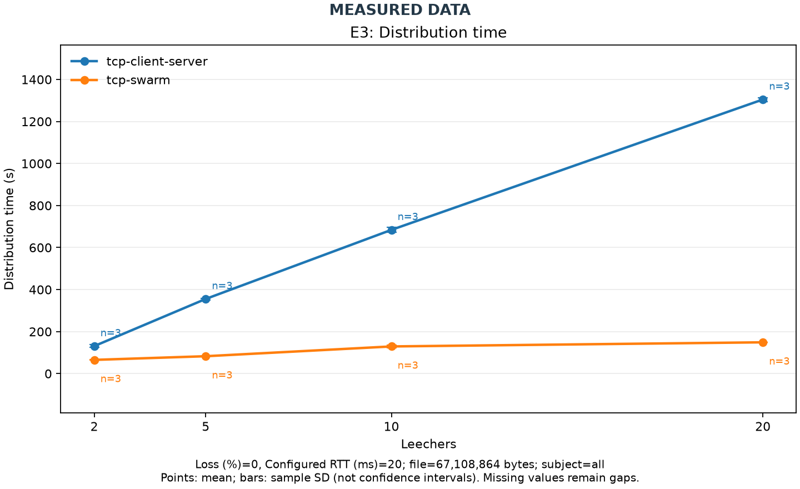

# E3 TCP distribution scaling

The Ubuntu sweep in `results/e3-work/final-reconnect/` distributed the same 64 MiB file at four peer counts, with 0% configured loss, 20 ms configured WAN RTT and 10 Mbit/s WAN and seed caps. Each mode and peer count completed one warm-up and three recorded trials. The table shows recorded-trial means. Completion time ends when the last leecher verifies its file. WAN savings compare R1's mean transmitted plus received bytes against client-server at the same peer count.

| Leechers | Client-server time (s) | Swarm time (s) | Seed share of swarm payload uploads | Swarm WAN savings |
|---:|---:|---:|---:|---:|
| 2 | 130.97 | 65.40 | 50.99% | −9.61% |
| 5 | 355.31 | 82.83 | 23.14% | 14.41% |
| 10 | 684.15 | 129.38 | 13.19% | 54.33% |
| 20 | 1,304.68 | 149.01 | 6.70% | 64.32% |

The swarm finished sooner at all four peer counts. At 20 leechers, client-server took 21 minutes 45 seconds on average and the swarm took 2 minutes 29 seconds. The seed supplied all uploaded payload in client-server and only 6.70% in the 20-leecher swarm, where leechers supplied the remaining 93.30%. With two leechers the swarm used 9.61% more WAN traffic, but at 20 it saved approximately 464 million bytes per trial.

The [seed upload share](E3-seed_upload_share-all.png) and [WAN traffic](E3-wan_bytes-all.png) plots show how the load changed with peer count. The [per-trial metrics](metrics.csv), [summary statistics](summary.csv), [WAN savings](wan-savings.csv) and [sweep manifest](run.json) accompany the plots.
