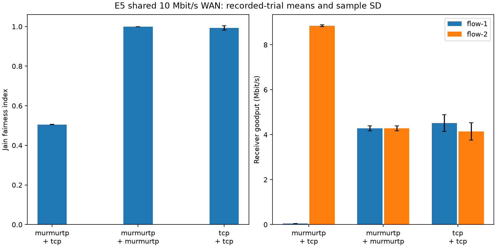

# E5 fairness on a shared WAN

Two simultaneous flows each transferred 64 MiB across the same 10 Mbit/s WAN
from LAN A to LAN B, with 20 ms configured RTT and 0% configured loss. All
three pairings completed one warm-up and three recorded trials on their first
attempt. Both receivers verified their payloads in every trial. Each table
entry is the mean ± sample standard deviation over the three recorded trials.

| Flow 1 / flow 2 | Flow 1 goodput (Mbit/s) | Flow 2 goodput (Mbit/s) | Jain fairness index |
|---|---:|---:|---:|
| MurmurTP / TCP CUBIC | 0.049 ± 0.003 | 8.850 ± 0.044 | 0.505502 ± 0.000340 |
| MurmurTP / MurmurTP | 4.283 ± 0.112 | 4.284 ± 0.115 | 0.99999984 ± 0.00000026 |
| TCP CUBIC / TCP CUBIC | 4.519 ± 0.369 | 4.140 ± 0.389 | 0.993075 ± 0.011468 |

Equal delivery rates give a Jain index of 1. The two MurmurTP flows shared
capacity almost equally, and two CUBIC flows averaged 0.9931. In the mixed
pairing, CUBIC accounted for 99.45% of the combined mean goodput during the
measurement window. MurmurTP still completed its file in every mixed trial.
These results quantify the imbalance for this route and configuration. The
receiver rates alone cannot identify its transport-level cause.

Both rates use the middle 60% of the time the two receivers were receiving
payload. This excludes time a flow spent transferring alone. The three
recorded trial windows per pairing can be reconstructed from the
[receiver counters](receiver-samples.csv) using the [experiment method](../../experiments/README.md#e5-competing-flow-fairness).

The [sweep manifest](run.json) identifies revision `9bf806c`. The
[trial metrics](metrics.csv) include warm-ups. The [summary](summary.csv)
contains the recorded means, sample deviations, minima and maxima. The
[mixed](E5-murmurtp-tcp/run.json), [MurmurTP](E5-murmurtp-murmurtp/run.json)
and [TCP](E5-tcp-tcp/run.json) checkpoints retain the per-trial byte counts,
measurement windows and payload digest.
